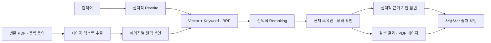

# 문서 검색 설정과 운영

2026-10-21 구현. **코드 작성 상태이며 실제 Cloudflare 연결·검색 품질·격리·복구 동작은 검증하지 않았다.** 테스트/빌드/브라우저 QA는 사용자 정책으로 실행하지 않았다. 기존 PDF 변환 후 사용자가 선택한 문서만 검색에 등록한다. 기존 문서의 일괄 외부 전송은 하지 않는다.

## 서비스 흐름

1. 변환 완료 PDF의 상세 화면에서 PDF 품질을 확인하고 검색 등록을 선택한다. 품질 상태가 `passed`가 아니면 별도의 확인 체크가 필요하다.
2. API 프로세스의 별도 비동기 작업이 Poppler `pdftotext`로 페이지 텍스트를 추출한다. 페이지 번호는 **변환 결과 PDF의 실제 물리 페이지 번호**다. HWP 인쇄 쪽번호나 원본 Office 쪽번호와 같다고 보장하지 않는다.
3. 페이지 텍스트를 Cloudflare AI Search built-in storage에 등록한다. Embedding과 keyword 색인을 관리형 서비스가 생성한다. 추출 텍스트 사본은 SQLite SearchPage에도 저장한다.
4. 준비 완료 후 문서 검색 화면에서 검색한다. 서버가 사용자 폴더를 지정하고 hybrid + RRF를 요청한다. 결과 키를 로컬 색인과 현재 문서 소유권·상태에 대조한다.
5. Rewrite와 Reranking은 사용자 선택 시 AI Search 옵션으로 적용한다. 답변 생성은 재조회 없이 승인된 결과만 Workers AI 모델에 제공한다. 기본 화면은 세 옵션 모두 꺼진 상태다.
6. `[S1]` 형식의 답변 출처는 검색 결과의 PDF 해당 페이지에 연결된다. 인용 번호 검사는 문장 사실성 검증이 아니므로 원문 확인이 필요하다.



정적 흐름: 등록 동의 → 페이지 추출/색인 준비 → 검색어(선택적 재작성) → 의미·키워드 검색/RRF → 선택적 재정렬 → 권한 확인 → 검색 결과/선택적 답변 → 사용자가 PDF 출처 확인.

## 활성화 전 필요한 설정

아래는 실행 안내이며 이 작업에서 실행하지 않았다. 외부 리소스 생성·유료 사용·운영 DB 변경·배포는 별도 운영 절차를 따른다.

- 기존 DB 백업 후 새 migration `20261021000000_document_search`를 적용해야 한다. 검색이 꺼져 있어도 문서 삭제 경로에서 tombstone 테이블을 사용하므로 migration이 필요하다. 일반 배포 명령은 `pnpm --filter @hwptopdf/api exec prisma migrate deploy`다. Docker의 기존 migration 시작 절차도 이 파일을 포함해야 한다.
- 기존 빌드 순서에 따라 shared → API/web를 빌드한다. 이 작업에서는 필요한 Prisma client 생성만 실행했고 DB migration·빌드는 실행하지 않았다.
- API 런타임에 Poppler `pdftotext`가 필요하다. 기존 Docker와 Ubuntu 설치 스크립트의 `poppler-utils`에 포함된다. 다른 로컬 환경에서는 별도 설치가 필요할 수 있다.
- Cloudflare AI Search instance가 active이며 vector·keyword 색인이 모두 켜져 있어야 한다. 한국어 검색을 위해 keyword tokenizer는 `trigram`으로 설정한다. 3글자 미만 질의의 키워드 매칭에는 제한이 있으며 의미 검색 품질도 실데이터로 평가해야 한다.
- API 토큰에는 해당 계정 AI Search 읽기·쓰기, 답변 사용 시 Workers AI 실행에 필요한 권한이 있어야 한다. 최소 권한과 계정 범위는 Cloudflare 대시보드에서 확인한다. 토큰을 프런트엔드 환경이나 Git에 넣지 않는다.

```dotenv
SEARCH_ENABLED=1
SEARCH_CF_ACCOUNT_ID=<account-id>
SEARCH_CF_API_TOKEN=<server-only-token>
SEARCH_CF_NAMESPACE=default
SEARCH_CF_INSTANCE=<instance-id>
SEARCH_ANSWER_MODEL=@cf/meta/llama-3.1-8b-instruct
```

`.env.example`과 두 Docker Compose 파일은 이 변수들을 지원한다. 로컬 실행에서는 실제 API 프로세스에 환경변수를 전달해야 한다. 기본 `SEARCH_ENABLED=0`이며, 필수 설정 누락 시 서버가 일반 경고를 기록하고 검색을 끈다. 변환 서비스는 계속 시작한다. 연결 가능 여부는 활성화 플래그만으로 보장하지 않는다.

## 상태와 복구

`queued → extracting → indexing → ready`, 실패 시 `failed`, 해제/삭제 시 `deleting → deleted`. 프로세스 재시작 시 DB에 남은 작업을 다시 가져온다. 페이지마다 결정적 key와 원격 item ID를 저장한다. 네트워크 응답이 유실되면 같은 key의 원격 item을 먼저 찾는다.

한 번에 한 페이지 작업을 처리하며 180초 lease로 동시 프로세스의 중복 실행을 제한한다. 실패는 지수 지연으로 최대 5회 시도 후 사용자의 재시도를 기다린다. 원격 색인 준비가 24시간을 넘으면 실패 상태가 된다. 사용자당 동시에 보관하는 검색 문서는 100개로 제한한다. 페이지 순서대로 색인을 처리하므로 큰 문서는 시간이 걸릴 수 있다. 이 수치는 안전 상한/정책값이며 측정된 성능 수치가 아니다.

PDF 추출 상한은 50MiB 입력, 16MiB 추출 출력, 2,000페이지, 60초다. 초과 문서는 조용히 자르지 않고 실패한다. 텍스트 없는 페이지는 누락 목록으로 표시한다. OCR·표 구조 복원·이미지 검색은 제공하지 않는다. 전체가 스캔인 문서는 검색 준비 실패로 표시한다. 부분 누락이 있는 문서는 텍스트가 있는 페이지만 검색한다.

## 삭제와 권한

- 사용자/보존기간 삭제는 작업 행 제거와 검색 tombstone 기록을 한 DB transaction에서 처리한다. 노출은 즉시 차단하고 텍스트 사본을 비운다. 원격 정리는 진행 중인 업로드 lease 종료와 유예시간 뒤 처리한다.
- 원격 정리가 끝날 때까지 페이지 key를 남긴다. API 프로세스가 중단되거나 `SEARCH_ENABLED=0`이면 원격 삭제도 대기한다. 삭제 완료 전부터 우리 서비스 검색에는 나오지 않는다.
- 원격 provider의 일관성 지연, 업로드 요청의 서버측 장기 처리, 계정 변경/장애 상황에서 원격 데이터가 즉시 완전히 지워진다고 보장하지 않는다. 운영 중 삭제 상태와 Cloudflare 데이터 정리가 맞는지 별도 확인해야 한다.
- provider의 계정/namespace/instance를 바꾸기 전에 기존 설정으로 모든 색인을 해제하고 삭제 완료를 확인해야 한다. scope가 다르면 기존 정리는 멈추고 경고를 기록한다. 새 자격증명으로 옛 계정 데이터가 지워진다고 처리하지 않는다.
- 계정 cascade 삭제 등으로 원본 job이 사라져도 SearchDocument/SearchPage가 남아 원격 정리를 수행할 수 있다. 이 테이블은 사용자/작업 FK cascade와 의도적으로 분리했다. 삭제 완료 tombstone에는 본문이 남지 않지만 내부 userId/jobId 등 관리 메타데이터는 남는다.
- 사용자 폴더는 ID의 SHA-256 앞 32 hex로 만든다. 폴더 필터는 검색 범위를 좁히는 수단이다. 실제 반환 권한은 전체 사용자 ID, 현재 job 상태와 outputKey, manifest key, ready 상태로 결정한다. 클라이언트는 provider 필터나 사용자 ID를 지정할 수 없다.
- 답변은 출처 번호가 없거나 허용되지 않은 번호가 있으면 숨긴다. 답변 생성 후 다시 조회한 문서 중 삭제된 것이 있으면 답변 전체를 버린다. 모델 답변은 plain text로 렌더링한다.

## API

| 경로 | 입력/결과 |
| --- | --- |
| GET `/api/search/config` | 로그인 필요, `{enabled}`; live 연결 성공을 의미하지 않음 |
| GET `/api/jobs/:id/search-index` | 자신의 문서 상태/전체·준비 페이지 수/누락 페이지 |
| POST `/api/jobs/:id/search-index` | `{confirmReview?:boolean}`; 사용자의 등록 요청 |
| DELETE `/api/jobs/:id/search-index` | 검색 해제, 원격 정리 대기 |
| POST `/api/search` | `{query,rewrite?,rerank?,answer?}`; 결과·답변·경고 |

검색어는 1~1,000자이며 whitespace-only는 거절한다. 검색/등록은 IP당 분당 10회 경로 제한이 있고 검색은 API 프로세스 안에서 사용자당 한 요청만 동시에 허용한다. 다중 API 인스턴스 전체의 비용 한도는 Cloudflare/배포 측 별도 정책이 필요하다. 검색 결과는 최대 10페이지, 각 본문은 최대 2,400자로 반환한다. 답변 모델은 이 제한된 근거만 받으므로 긴 표/문서 전체 요약에는 적합하지 않을 수 있다.

## 후속 검증 시나리오 — 이번 작업에서 미실행

1. 한국어/혼합 언어/표/빈 페이지가 있는 실제 PDF로 페이지 번호와 스니펫 비교.
2. 두 사용자에서 같은 질의를 보내 다른 사용자 결과가 원격 후보에 있어도 반환/답변 입력에서 제외되는지 확인.
3. 업로드 응답 유실, 프로세스 재시작, 색인 중 삭제, 보존기간 삭제 및 원격 삭제 실패 후 복구.
4. 문서 품질 review/unknown 동의, 재등록, provider 변경, 기능 비활성화 시 UI와 정리 상태 확인.
5. Rewrite·Reranking on/off 비교, 근거 없는 질문, 위조 출처 번호, 답변 생성 중 문서 삭제.
6. 실제 계정으로 API 스키마·토큰 권한·모델 가용성과 한국어 검색/답변 품질 및 비용 측정.

공식 참고: [Items REST API](https://developers.cloudflare.com/ai-search/api/items/rest-api/), [Search API](https://developers.cloudflare.com/api/resources/ai_search/subresources/namespaces/subresources/instances/methods/search/), [Keyword search](https://developers.cloudflare.com/ai-search/configuration/indexing/keyword-search/).
